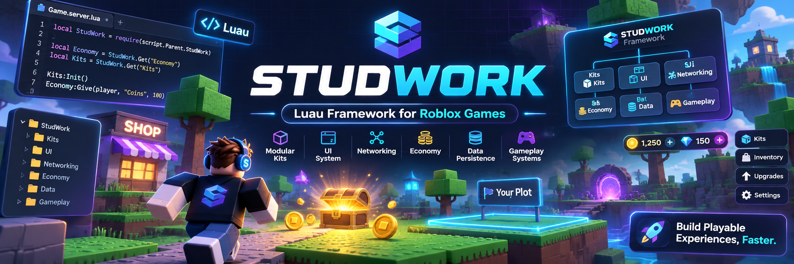

<p align="center">
  
</p>

# StudWork

[](https://github.com/RandyjCrowley/studwork/actions/workflows/ci.yml)
[](LICENSE)

**StudWork** is an opinionated Roblox game framework written in Luau (`--!strict`). It makes good
decisions for you, so a new game is playable within minutes: a game that sets only its name and
items gets rarity tiers, a mobile-first theme, a HUD, an income economy, luck with disclosed odds,
rebirth, streaks, offline earnings and co-play detection.

- **Opinionated defaults you can override.** Every decision can be changed, in five levels: use the
  defaults, change config, replace a piece, switch a kit off, write your own module
  ([override levels](docs/framework/override-levels.md)). The framework never becomes something
  you have to work around.
- **Nothing is special.** The built-in kits use only the public module API that a third-party
  module has. If a kit can do it, so can your module.
- **Guardrails you can't turn off.** `tools/lint` refuses client-trusted remotes, purchases outside
  the receipt-safe path, balance numbers outside config, modules reaching into framework internals,
  and hard-coded colours in UI code ([guardrails](docs/framework/guardrails.md)).

What's inside: a small foundation (`packages/framework`: boot, save sections with migrations and
atomic transactions, receipt-safe purchases, validated and rate-limited networking, compliance for
paid random items, replication), optional kit modules (`packages/kits`), a theme-driven React UI
kit (`packages/ui`), and tools (lint, strict type checking, a Lune test harness, a multi-server
simulation, generators, publishing). Why it is built this way: [docs/philosophy.md](docs/philosophy.md).

## Requirements

- macOS or Linux with `bash` (the tools are bash scripts; Windows via WSL is untested).
- [Rokit](https://github.com/rojo-rbx/rokit). It installs the pinned toolchain from `rokit.toml`:
  Rojo 7.7.1, Wally 0.3.2, Lune 0.11.1, Selene 0.32.0, StyLua 2.6.0, Blink 0.18.9, luau-lsp 1.70.1.
  On macOS, Wally 0.3.2 ships only an x86_64 binary, so Apple Silicon needs Rosetta 2.
- Roblox Studio with the [Rojo plugin](https://rojo.space/docs/v7/getting-started/installation/)
  (7.7.x, to match Rojo 7.7.1).

## Quick start: a new game (5 minutes)

Install Rokit (see its README), then let StudWork create your game's repository: the repo root is
the game and StudWork is a git submodule (`studwork/`) pinned at a release tag
([single-game projects](docs/framework/single-game-project.md)):

```sh
git clone https://github.com/RandyjCrowley/studwork.git
studwork/tools/install       # the pinned toolchain for this clone (new-project runs on it)
studwork/tools/new-project my-game --modules Items,Rarity,Inventory,Economy
cd my-game
tools/doctor    # every line should say ok
tools/dev       # rojo serve + the Studio connect steps
```

`studwork/tools/new-project --help` lists every option. It installs the toolchain and Wally packages,
scaffolds a game that boots and passes lint, typecheck, test and build, enables the pre-commit hook
and makes the first commit. (The first `tools/typecheck` downloads the Roblox type definitions once,
into the project's git-ignored `.cache/`; `tools/new-project` copies them from your StudWork clone
when it has them, and `tools/typecheck --offline` never downloads.) Specs: `tools/test`; after
hand-writing code run `tools/format`, then `tools/lint`. How to spec your game module against the
kits: [docs/framework/testing.md](docs/framework/testing.md).
Every tool in the project works without a game name: `tools/lint`, `tools/test`, `tools/build`,
`tools/make-module <Name>`, `tools/publish --test --dry-run`. The project's `README.md` and
`CLAUDE.md` explain the rest.

## Try the sandbox

1. Clone and install:

   ```sh
   git clone https://github.com/RandyjCrowley/studwork.git
   cd studwork
   tools/install   # rokit install + wally install (into deps/) + the pre-commit hook
   tools/doctor    # every line should say ok
   ```

2. Serve the sandbox, a playable reference game that uses every kit:

   ```sh
   tools/dev sandbox
   ```

   This prints the Studio steps and runs Rojo on the sandbox's port, 34872. Without the wrapper:

   ```sh
   rojo serve examples/sandbox/default.project.json --port 34872
   ```

3. In Roblox Studio, open a new Baseplate, then **Plugins > Rojo**, set the port to `34872`
   (address `localhost`) and **Connect**.

4. Press **Play**. You get a plot and the StudWork HUD: touch the glowing block to get an item, it
   goes on your plot and earns coins every second, and the action bar has Upgrade, Chest, Robux egg
   and Rebirth buttons ([docs/manual-qa.md](docs/manual-qa.md) has the full checklist and the
   server console). Edit code in your editor; Rojo syncs on save.

To build a place file instead: `tools/build sandbox` (writes `build/sandbox.rbxl`).
More examples: `examples/overrides/ov-a` … `ov-f` (one override case each) and
`examples/modules/session-leaderboard` (a third-party-style module).

## Adopt StudWork in an existing game

Already have a Roblox game (a Rojo repo or a Studio place file)? StudWork can take it over without
losing a save or a Robux purchase: each player's old save is read once, on join, and never written;
old receipts are never granted twice. A coding agent does the work; you do the cutover. Give your
agent this ([the full prompt](docs/agents/migrate-prompt.md)):

```text
Here's StudWork at <studwork>. Here's my game at <game>. Migrate it to StudWork following
<studwork>/docs/agents/adopt-existing-game.md.
```

The tools it uses, from a StudWork checkout:

```sh
tools/adopt --from-place my-game/Place.rbxl --out my-game   # Studio-only games: extract the code
tools/adopt --audit my-game        # read-only report + migration plan
tools/adopt --init my-game --name my-game --modules Items,Inventory,Economy
tools/test-migration               # in the game: sample old saves through the import
tools/adopt --verify my-game       # nothing unsafe for going live is left
```

The agent playbook: [docs/agents/adopt-existing-game.md](docs/agents/adopt-existing-game.md). The
design: [docs/framework/adopting.md](docs/framework/adopting.md). Agents start at [AGENTS.md](AGENTS.md).

## Using StudWork in your games

Games don't live in this repo. The simplest setup is one repository per game made by
`tools/new-project` (above; [single-game-project.md](docs/framework/single-game-project.md)).
The alternative, several games in one repo: make a **games repo** that has StudWork as a git submodule at
`roblox-core/` (the tools expect that folder name, which is why you'll see it in the docs), pinned at
a release tag, and copy the skeleton from
[`templates/games-repo/`](templates/games-repo/). Its `tools/` wrappers run this repo's tools
against your games:

```sh
git submodule add https://github.com/RandyjCrowley/studwork.git roblox-core
git -C roblox-core checkout v1.5.0
tools/new-game my-game --modules Items,Rarity,Inventory,Economy   # from the games repo
```

The full setup and everyday commands: [docs/framework/games-repo.md](docs/framework/games-repo.md).
A Wally package (`randyjcrowley/studwork`) is planned but not published yet.

## Kits

Each kit is optional; list the modules you want in `GameConfig.modules`.

| Kit | Modules | What it does |
|---|---|---|
| collection | Items, Rarity, Inventory | item definitions; rarity rolls with luck, pity, mutations and disclosed odds; an inventory with gifting |
| economy | Economy, Upgrades, Rebirth, Offline | currencies and income, upgrade cost curves, rebirth, capped offline earnings |
| base | Plot | a player plot with display slots |
| social | Friends, Mail, TextFilter | co-play detection and bonus; cross-server mail with a mailbox; Roblox text filtering by audience |
| engagement | Streak, Leaderboards, Badges, Notifications | daily login streaks with a grace period; all-time and periodic leaderboards; badge awards with retries; experience notifications and the opt-in prompt |
| quests | Quests, Goals | daily, weekly, event and story quests with rewards and rerolls; a guided goal chain with an on-screen pointer |
| carry | Carry, Movement | objects carried by one or more players (hand-off, throw and catch, drop rules, delivery zones); a server-side movement validator |
| companions | Companions | equip owned item copies as followers, with equip-best and capped income bonuses |
| player | Codes, Settings | free promotion codes with durable global caps; validated player preferences and accessibility settings |
| moderation | Admin, Moderation, Reports | staff roles, permissions and the staff panel; bans, kicks, mutes, warnings and an audit log; player reports and the staff queue |

Framework features (always on, not modules): environments and feature flags, localization.

Details: [docs/framework/kits/](docs/framework/kits/).

## Documentation

Start at the docs index, [docs/README.md](docs/README.md). Main pages:

- [Philosophy](docs/philosophy.md): why StudWork is opinionated.
- [Getting started](docs/framework/getting-started.md)
- [Module API](docs/framework/module-api.md) (the contract; source of truth) and the
  [module reference](docs/framework/module-reference.md)
- [Override levels](docs/framework/override-levels.md)
- [Guardrails](docs/framework/guardrails.md)
- [Single-game projects](docs/framework/single-game-project.md) (`tools/new-project`)
- [Games repo](docs/framework/games-repo.md) (several games in one repo)
- [Adopting StudWork in an existing game](docs/framework/adopting.md) and the agent playbook,
  [docs/agents/adopt-existing-game.md](docs/agents/adopt-existing-game.md) ([AGENTS.md](AGENTS.md) for coding agents)
- [Theme](docs/framework/theme.md)
- [Kits](docs/framework/kits/)
- [Decisions](docs/decisions.md): why things are the way they are.
- [Known issues](docs/known-issues.md)
- [CHANGELOG.md](CHANGELOG.md)

## Versioning

StudWork follows [Semantic Versioning](https://semver.org/). Within a major version the module
API only grows: additions are documented in `docs/framework/module-api.md` §19+ and marked
`(added in ...)`, nothing is renamed or removed, and deprecated calls keep working. Modules declare
a range such as `framework = "^1.3.0"`. Release tags (`vX.Y.Z`) never move.

## Status and limitations

StudWork is young (1.x) and used by a small number of games. Open issues and known gaps are listed
in [docs/known-issues.md](docs/known-issues.md). The Wally package is not published yet.

## Contributing

See [CONTRIBUTING.md](CONTRIBUTING.md). Report security problems privately: [SECURITY.md](SECURITY.md).
This project follows the [Contributor Covenant](CODE_OF_CONDUCT.md).

## Licence

[MIT](LICENSE). Copyright (c) 2026 RandyjCrowley.
